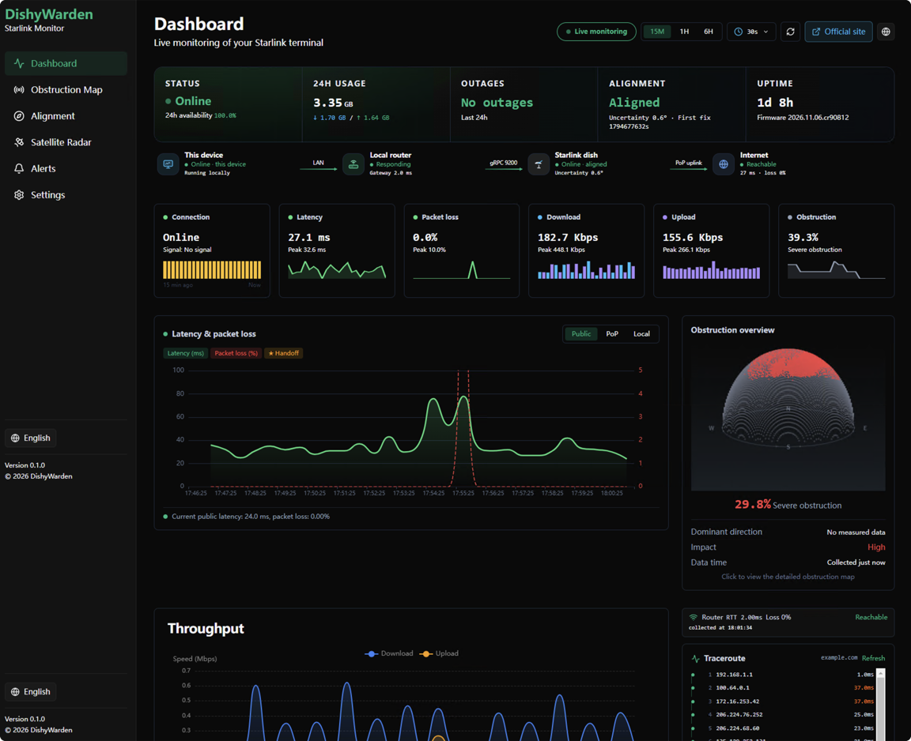
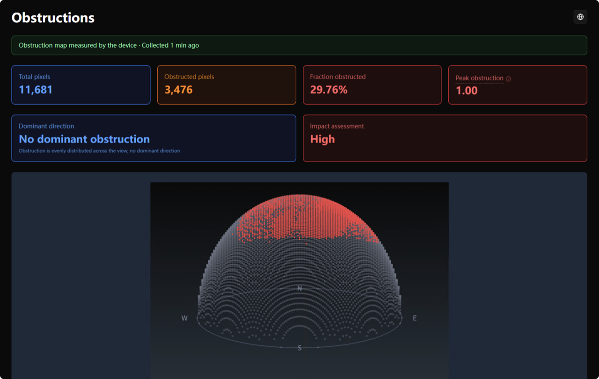

<!--
  本文件由 scripts/gen-readme.mjs 自动生成 —— 请勿直接编辑。
  源文件：docs/readme/ko.md
  改完源文件后执行：node scripts/gen-readme.mjs
-->

<div align="center">

     

</div>

<div align="center">
  <a href="./README.md">English</a> · <a href="./README.zh-CN.md">简体中文</a> · <a href="./README.ja.md">日本語</a> · <strong>한국어</strong> · <a href="./README.vi.md">Tiếng Việt</a>
</div>

# DishyWarden

**Starlink 단말을 위한 오픈소스 모니터링 도구** ——
단말의 로컬 gRPC API에 연결해 raw한 수치를 그대로 쓸 수 있는 정보로 바꾸고,
문제가 생기면 즉시 알려줍니다.

> 데이터는 기본적으로 사용자 컴퓨터에만 남습니다. 선택형 클라우드 채널이
> 전송하는 것은 익명 버전 번호와 **사용자가 명시적으로 허용한** 오탐 신고뿐입니다
> ([개인정보](#-개인정보) 참고).

---

## 📸 스크린샷

| 대시보드 | 차폐 지도 |
|---|---|
|  |  |

> 실제 세션에서 캡처한 화면이며, 목업이 아닙니다.

---

## ✨ 무엇을 할 수 있나

**실시간 모니터링**

- 신호 세기, 지연 시간, 패킷 손실, 처리량, 가동률 ——
  30초 간격으로 수집해 로컬 SQLite에 저장
- 위성 레이더: 실제 TLE + SGP4 전파, 극좌표 플롯,
  통신 위성을 향한 빔 방향 추정
- 하늘 차폐 지도: WebGL 반구 투영으로 차폐 영역을 그리고, 차폐율·차폐 등급·
  주된 차폐 방향과 그 추이를 표시
- 정렬 화면: 방위각과 고도각으로 수동 조준

**의미 있는 알림**

- **27개의 내장 규칙** — 안테나 오프라인, PoP 지연, 심각한 패킷 손실,
  시야 차폐, 과열로 인한 다운클로킹, 조준 오류, 모터 고장, GNSS 이상, 결빙 제빙,
  PoE/전원, 라우터 오프라인, 반복 재연결, WiFi 품질, 악천후,
  계정 이상, 위성 로밍 등
- 세 가지 발송 채널: **Telegram**, **이메일**, **Webhook**
  (템플릿 변수와 재사용 가능한 페이로드 템플릿 지원)
- 오프라인 큐: 회선이 끊긴 동안 쌓인 알림을 복구 후 한꺼번에 전달
- 프로브 억제: 프로브 장애가 원인이면 같은 알림이 두 번 울리지 않음

**네트워크 인사이트**

- 경로 추적과 홉 단위 경로 지도
  (Windows `tracert` 출력은 열 단위로 파싱)
- 노드 프로브는 세 종류 — **ICMP**, **DNS**, **TLS** ——
  문제가 단말·라우터·경로 어디에서 생겼는지 구분
- Prometheus 지표와 바로 쓸 수 있는 Grafana 대시보드

**위치 정보**

- 단말 위치는 3단계 폴백: 단말 GPS → 브라우저 위치 정보 → IP 기반 대략 추정

**오래 유지할 수 있게 설계**

- UI 지원 언어 5개: English, 简体中文, 日本語, 한국어, Tiếng Việt
- 설정은 평범한 JSON, 원격 측정 데이터와 알림은 로컬 SQLite

---

## 🚀 빠른 시작

**Node.js 20+** 와 연결 가능한 단말이 필요합니다.

```bash
git clone https://github.com/arielxinzheng/DishyWarden.git
cd DishyWarden
npm install
npm run dev
```

`npm run dev` 는 Vite 개발 서버와 Electron을 함께 띄웁니다. 창은
`http://localhost:5173` 의 렌더러를 불러옵니다. **기능 확인은 Electron 창에서
하세요** — 브라우저 빌드에는 목업 데이터만 있습니다.

### 단말 연결하기

DishyWarden는 단말의 **로컬 gRPC API**를 사용합니다:

| 포트 | 전송 방식 | 역할 |
|---|---|---|
| `9200` | 네이티브 gRPC | 주 경로 |
| `9201` | grpc-web | 대체 경로 — 일부 펌웨어는 9200에서 `UNIMPLEMENTED` 를 돌려줍니다 |

단말은 이 API를 LAN에 노출하지 않으므로 보통은 같은 컴퓨터에서 단말로
전달하는 **로컬 브리지**(`dishylink` 같은 도구)를 띄우고,
**설정 → 단말 연결** 에 주소와 포트를 입력합니다. 필드 단위 비교는
[`docs/DISH-API-GAPS.md`](docs/DISH-API-GAPS.md),
응답이 없을 때는 [`docs/DISH-CONNECTIVITY-ISSUES.md`](docs/DISH-CONNECTIVITY-ISSUES.md)
를 참고하세요.

---

## 🏗️ 소스에서 빌드

```bash
npm ci
npm run build          # 렌더러 + 메인 프로세스 + electron-builder
npm run build:win      # Windows NSIS 설치 프로그램만
```

| 산출물 | 비고 |
|---|---|
| `release/` | 패키지 출력 디렉터리(electron-builder target) |
| `release/DishyWarden-Setup-<version>.exe` | Windows 설치 프로그램, per-machine(관리자 권한 필요), 안내 방식 설치 |

커밋 전에 아래 검사를 돌려 보세요:

```bash
npx tsc --noEmit -p tsconfig.json
npx tsc --noEmit -p tsconfig.electron.json
npm test               # vitest
npm run lint
```

---

## 📥 릴리스 설치

[릴리스 페이지](https://github.com/arielxinzheng/DishyWarden/releases)에서 최신 산출물을 받으세요.

| 플랫폼 | 파일 |
|---|---|
| Windows x64 / arm64 | `DishyWarden-Setup-<version>.exe` (NSIS, per-machine) |
| macOS arm64 / x64 | `DishyWarden-<version>-<os>-<arch>.dmg` |

> **빌드에는 코드 서명이 없습니다.** Windows에서 SmartScreen 경고
> (“Windows가 PC를 보호했습니다”)가 뜨면 *자세히 정보 → 계속 실행* 을 누르세요.
> macOS는 격리되므로 `.dmg` 를 우클릭해 *열기* 를 선택하거나
> `xattr -dr com.apple.quarantine /Applications/DishyWarden.app` 를 실행하세요.
> 각 산출물 옆에 `sha512` 값이 함께 공개되니 대조해 보세요.

업데이트는 [electron-updater](https://github.com/electron-userland/electron-builder)
가 매니페스트 `https://github.com/arielxinzheng/DishyWarden/releases/latest/download/latest.yml` 로 배포합니다. 시작할 때 한 번, 이후 대략 12시간마다
확인하며 네트워크를 쓸 수 없으면 조용히 물러납니다.

---

## 📋 요구 사항

| | |
|---|---|
| OS | Windows 10+, macOS 11+, Linux (X11) |
| Node.js | 20+ (개발에만 필요) |
| 런타임 | Electron 33 · React 18 · TypeScript · Vite · Tailwind CSS 4 |
| 저장 공간 | 원격 측정 데이터 약 1 MB/일 (30초 간격 수집) |

---

## 🔐 개인정보

**명시적으로 허용하지 않는 한 원격 측정 데이터는 이 컴퓨터를 벗어나지 않습니다.**

| 데이터 | 전송처 | 시점 |
|---|---|---|
| 원격 측정 데이터, 알림, 설정 | 로컬 SQLite / 로컬 JSON | 항상, 사용자 컴퓨터 안에서만 |
| 업데이트 확인(`upgrade_check` / `upgrade_heartbeat`) | `cloud.dishywarden.com` | 자동 — 익명 `client_id`, 앱 버전, 플랫폼, IP 만 전송 |
| 오탐 신고 | `cloud.dishywarden.com` | **허용한 경우에만** — 알림 종류, 등급, 제목, 메모, (유지했다면) 좌표 |

- `client_id` 는 이 컴퓨터에서 만든 무작위 UUID이며, 하드웨어·계정·네트워크
  식별자에서 파생되지 않습니다.
- 오탐 신고 전송은 **기본적으로 꺼져 있고**, *설정 → 업데이트 및 피드백* 에서
  언제든지 끌 수 있습니다. 첫 전송 시에는 무엇을 보낼지 보여주고 명시적으로
  동의를 받습니다.
- 클라우드 서버는 계정, 알림 자격 증명(Telegram 토큰, webhook URL, 이메일
  비밀번호), 파일 경로, 호스트 이름을 **전달받지 않습니다**.
- 서버 보관 기간: 업데이트 이벤트와 피드백 90일, 접근 로그 14일.

자세한 내용은 **[PRIVACY.md](PRIVACY.md)** 를 보세요.

---

## 🧩 아키텍처

```
src/
├── main/        Electron 메인 프로세스 — 창, IPC, gRPC 클라이언트, 업데이터
├── core/        단말 gRPC 클라이언트, 프로브, 경로 추적, 업데이터, 클라우드
├── storage/     SQLite 영속화(원격 측정 + 알림)와 설정
├── alerting/    규칙 엔진, 알림 디스패처, 오프라인 큐
├── collector/   30초 수집 루프
├── prometheus/  지표 내보내기와 Grafana 대시보드
└── renderer/    React UI(대시보드, 알림, 차폐, 위성, 정렬, 설정)
```

기여자가 알아야 할 계층 규칙:

- `src/storage/types.ts` 는 네이티브 모듈을 import 하면 안 됩니다 ——
  렌더러가 이 파일을 import 합니다
- `src/main/**`, `src/core/**`, `src/storage/**` 을 고치면 Electron을 다시
  시작해야 하고, 렌더러만 고치면 핫 리로드됩니다
- 새 UI 문자열은 다섯 언어 모두에 있어야 하며, i18n 키 집합 테스트가 이를 검사합니다

---

## 📚 추가 문서

| 문서 | 내용 |
|---|---|
| [`docs/DISH-API-GAPS.md`](docs/DISH-API-GAPS.md) | `dishylink`와의 필드 단위 비교 — 포트 이름, 응답 구조, 알려진 장애 |
| [`docs/DISH-CONNECTIVITY-ISSUES.md`](docs/DISH-CONNECTIVITY-ISSUES.md) | 단말이 응답하지 않는 이유와 좁혀 가는 방법 |
| [`docs/VERIFY-DISH.md`](docs/VERIFY-DISH.md) | 실제 Windows 머신에서의 원격 검증 절차 |
| [`docs/WINDOWS-BUILD.md`](docs/WINDOWS-BUILD.md) | Windows에서 패키징하기 |
| [`docs/CLOUD-UPGRADE.md`](docs/CLOUD-UPGRADE.md) | 업데이트 매니페스트 계약과 릴리스 방법 |

## 🛠️ 기여하기

Issue 와 Pull Request 를 환영합니다 — 개발 환경, 커밋 규칙, 릴리스 절차는
[CONTRIBUTING.md](CONTRIBUTING.md) 를 참고하세요.

## 📄 라이선스

[MIT](LICENSE) © 2026 DishyWarden contributors
