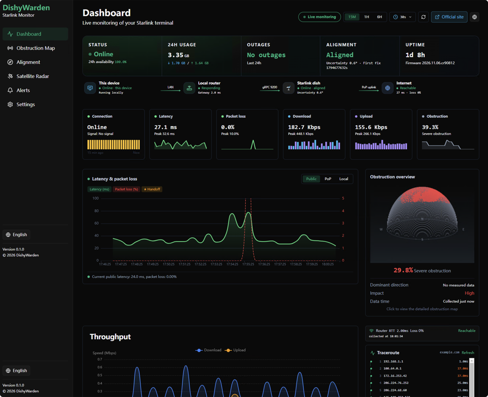
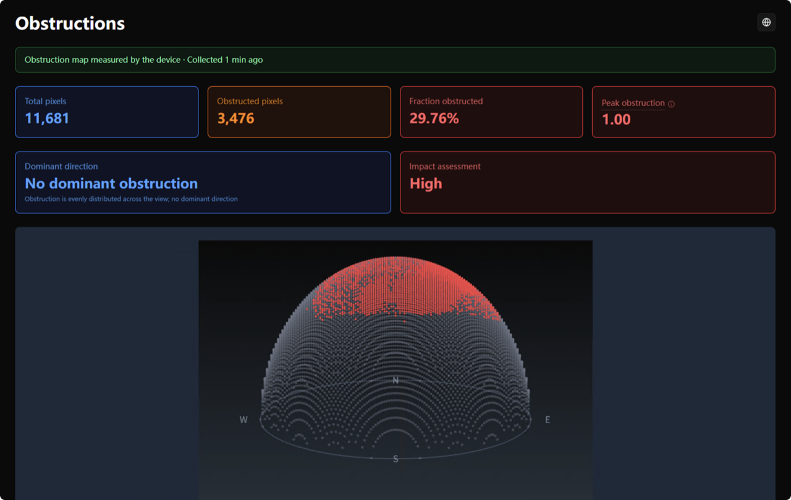

<!--
  本文件由 scripts/gen-readme.mjs 自动生成 —— 请勿直接编辑。
  源文件：docs/readme/en.md
  改完源文件后执行：node scripts/gen-readme.mjs
-->

<div align="center">

     

</div>

<div align="center">
  <strong>English</strong> · <a href="./README.zh-CN.md">简体中文</a> · <a href="./README.ja.md">日本語</a> · <a href="./README.ko.md">한국어</a> · <a href="./README.vi.md">Tiếng Việt</a>
</div>

# DishyWarden

**Open-source monitoring for Starlink terminals** — a desktop app that talks to your
dish over its local gRPC API, turns the raw numbers into something you can act on,
and tells you the moment something goes wrong.

> Data stays on your machine. The optional cloud channel only carries an anonymous
> version number and an opt-in false-positive report — see [Privacy](#-privacy).

---

## 📸 Screenshots

| Dashboard | Obstruction map |
|---|---|
|  |  |

> Screenshots are captured from a real session; they are not mock-ups.

---

## ✨ What you get

**Live monitoring**

- Signal level, latency, packet loss, throughput and availability — sampled every 30 s
  and stored locally in SQLite
- Satellite radar: real TLEs + SGP4 propagation, polar plot, and beam-pointing
  estimation toward the serving satellite
- Sky obstruction map: WebGL hemisphere showing the obstruction sky, with obstruction
  percentage, severity level, dominant direction and its trend
- Alignment view: azimuth/elevation for manual dish pointing

**Alerts that mean something**

- **27 built-in rules** — antenna offline, PoP latency, severe packet loss,
  obstruction, thermal throttling, mis-pointing, motor fault, GNSS trouble,
  icing, PoE/power, router offline, flapping, WiFi quality, weather, and more
- Three delivery channels: **Telegram**, **E-mail**, **Webhook** (with template
  variables and a reusable payload template)
- Offline queue: alerts raised while the link is down are delivered once it recovers
- Probe suppression: an alert caused by a failing probe does not fire twice

**Network insight**

- Route tracing with a per-hop link map (Windows `tracert` output is parsed column-wise)
- Probe nodes with three probe types — **ICMP**, **DNS**, **TLS** — for checking
  whether the problem is the terminal, the router, or the path
- Prometheus metrics + a ready-made Grafana dashboard

**Localisation**

- Terminal position, resolved through a three-step fallback chain:
  terminal GPS → browser geolocation → coarse IP-based estimate

**Built to be maintained**

- 5 UI languages: English, 简体中文, 日本語, 한국어, Tiếng Việt
- Settings live in a plain JSON file; telemetry and alerts live in local SQLite

---

## 🚀 Quick start

Requires **Node.js 20+** and a terminal you can reach.

```bash
git clone https://github.com/arielxinzheng/DishyWarden.git
cd DishyWarden
npm install
npm run dev
```

`npm run dev` starts the Vite dev server and Electron together. The window opens
against the renderer at `http://localhost:5173`; **verify features in the Electron
window** — the browser build only renders mock data.

### Connecting to your dish

DishyWarden talks to the terminal's **local gRPC API**:

| Port | Transport | Role |
|---|---|---|
| `9200` | native gRPC | primary |
| `9201` | grpc-web | fallback — some firmware answers `UNIMPLEMENTED` on 9200 |

The dish does not expose this API to the LAN, so you normally point the app at a
**local bridge** that proxies to the terminal (for example a `dishylink`-style
tool running on the same machine). Configure the address and ports in
**Settings → Terminal connection**. See
[`docs/DISH-API-GAPS.md`](docs/DISH-API-GAPS.md) for the field-level comparison
against `dishylink`, and [`docs/DISH-CONNECTIVITY-ISSUES.md`](docs/DISH-CONNECTIVITY-ISSUES.md)
if the terminal refuses to answer.

---

## 🏗️ Build from source

```bash
npm ci
npm run build          # renderer + main process + electron-builder
npm run build:win      # Windows NSIS installer only
```

| Output | Notes |
|---|---|
| `release/` | packaged output (`electron-builder` target directory) |
| `release/DishyWarden-Setup-<version>.exe` | Windows installer, per-machine (needs administrator rights), assisted install |

Useful checks before you commit:

```bash
npx tsc --noEmit -p tsconfig.json
npx tsc --noEmit -p tsconfig.electron.json
npm test               # vitest
npm run lint
```

---

## 📥 Install a release

Download the latest asset from the [releases page](https://github.com/arielxinzheng/DishyWarden/releases):

| Platform | Asset |
|---|---|
| Windows x64 / arm64 | `DishyWarden-Setup-<version>.exe` (NSIS, per-machine) |
| macOS arm64 / x64 | `DishyWarden-<version>-<os>-<arch>.dmg` |

> **The builds are not code-signed.** Windows will show a SmartScreen warning
> ("Windows protected your PC") — click *More info → Run anyway*. macOS will
> quarantine the app — right-click the `.dmg` and choose *Open*, or run
> `xattr -dr com.apple.quarantine /Applications/DishyWarden.app`.
> Verify the download with the `sha512` value published next to each asset.

Upgrades are delivered by [electron-updater](https://github.com/electron-userland/electron-builder)
through the manifest at `https://github.com/arielxinzheng/DishyWarden/releases/latest/download/latest.yml`; the app checks on startup and roughly every
12 hours, silently degrading if the network is unavailable.

---

## 📋 Requirements

| | |
|---|---|
| OS | Windows 10+, macOS 11+, Linux (X11) |
| Node.js | 20+ (development only) |
| Runtime | Electron 33 · React 18 · TypeScript · Vite · Tailwind CSS 4 |
| Storage | ~1 MB per day of telemetry (30 s sampling) |

---

## 🔐 Privacy

**Your telemetry never leaves your machine unless you explicitly allow it.**

| What | Where it goes | When |
|---|---|---|
| Telemetry, alerts, settings | local SQLite / local JSON | always, on your machine |
| Upgrade check (`upgrade_check` / `upgrade_heartbeat`) | `cloud.dishywarden.com` | automatic — carries only an anonymous `client_id`, app version, platform and your IP |
| False-positive report | `cloud.dishywarden.com` | **opt-in only** — carries the alert type, severity, title, your note, and (if you keep it) coordinates |

- The `client_id` is a random UUID generated on your machine. It is not derived
  from hardware, account or network identifiers.
- The false-positive upload is **off by default** and can be switched off at any
  time in *Settings → Upgrade & feedback*. The first upload asks for explicit
  confirmation and shows you exactly what will be sent.
- The cloud server never receives your account, notification credentials
  (Telegram token, webhook URL, e-mail password), file paths or host names.
- Server-side retention: upgrade events and feedback 90 days, access logs 14 days.

Full details: **[PRIVACY.md](PRIVACY.md)**.

---

## 🧩 Architecture

```
src/
├── main/        Electron main process — windows, IPC, gRPC client, updater
├── core/        Dish gRPC client, probe runners, traceroute, updater, cloud client
├── storage/     SQLite persistence (telemetry + alerts) and config
├── alerting/    Rule engine, notification dispatcher, offline queue
├── collector/   30 s sampling loop
├── prometheus/  Metrics export + Grafana dashboard
└── renderer/    React UI (Dashboard, Alerts, Obstruction, Satellite, Alignment, Settings)
```

Layer rules worth knowing if you contribute:

- `src/storage/types.ts` must not import native modules — the renderer imports it
- `src/main/**`, `src/core/**`, `src/storage/**` changes require an Electron
  restart; renderer changes hot-reload
- Every new UI string needs all five languages, and the i18n key-set test enforces it

---

## 📚 Further documentation

| Document | What it covers |
|---|---|
| [`docs/DISH-API-GAPS.md`](docs/DISH-API-GAPS.md) | Field-level comparison against `dishylink` — port names, response shapes, known outages |
| [`docs/DISH-CONNECTIVITY-ISSUES.md`](docs/DISH-CONNECTIVITY-ISSUES.md) | Why a terminal stops answering, and how to narrow it down |
| [`docs/VERIFY-DISH.md`](docs/VERIFY-DISH.md) | Remote verification workflow on a real Windows machine |
| [`docs/WINDOWS-BUILD.md`](docs/WINDOWS-BUILD.md) | Packaging the app on Windows |
| [`docs/CLOUD-UPGRADE.md`](docs/CLOUD-UPGRADE.md) | The update-manifest contract and how a release is published |

## 🛠️ Contributing

Issues and pull requests are welcome — see [CONTRIBUTING.md](CONTRIBUTING.md)
for the development setup, the commit convention and the release flow.

## 📄 License

[MIT](LICENSE) © 2026 DishyWarden contributors
